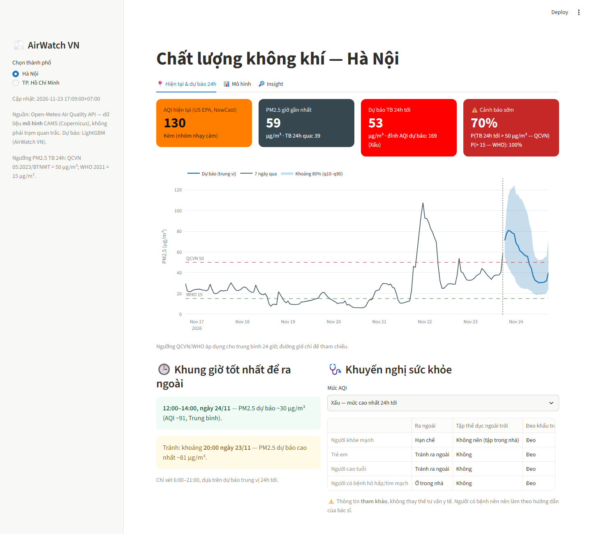
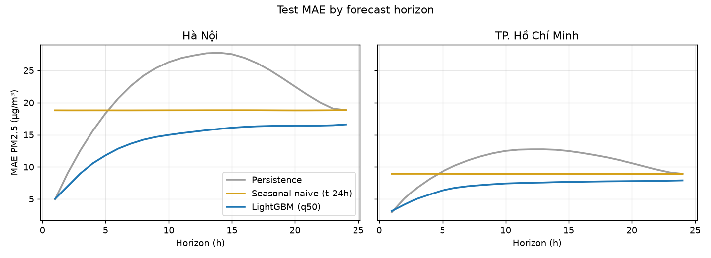
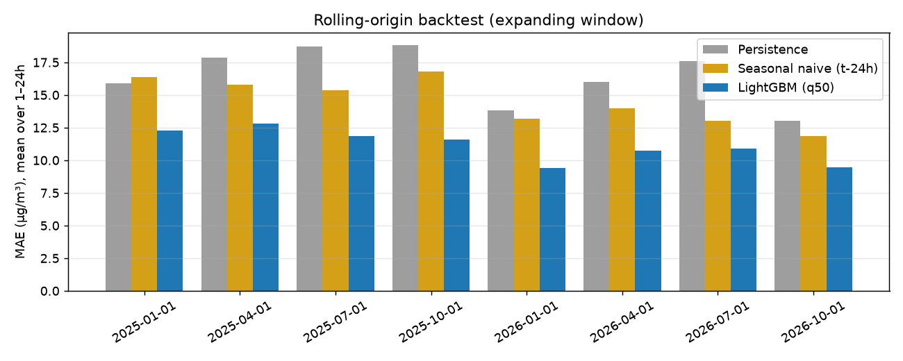
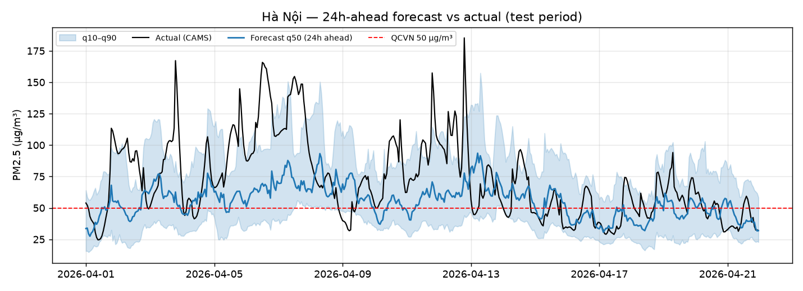
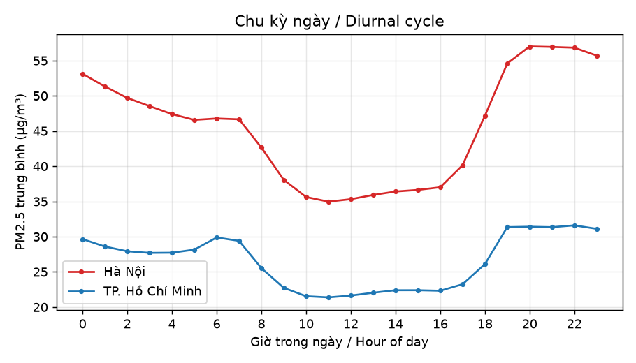
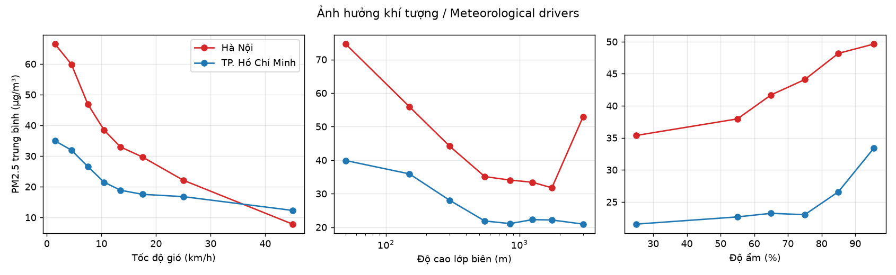
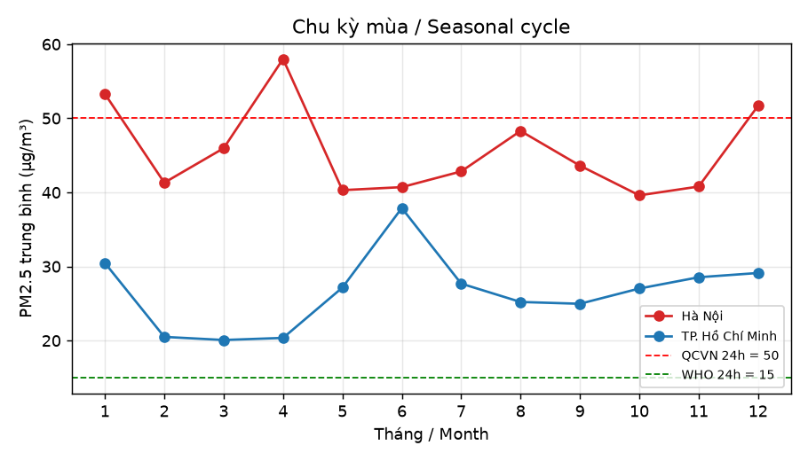
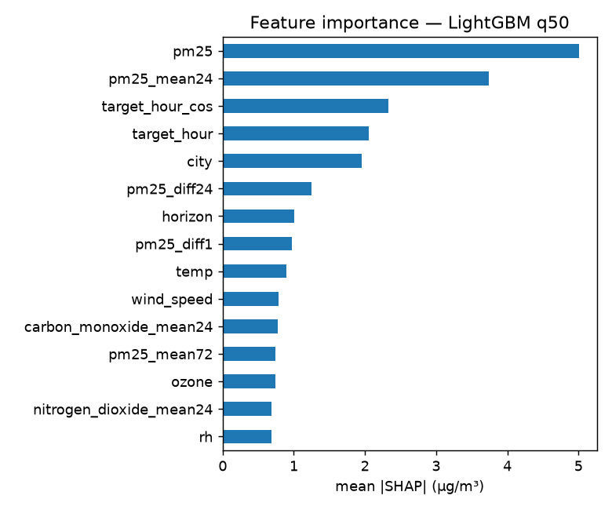
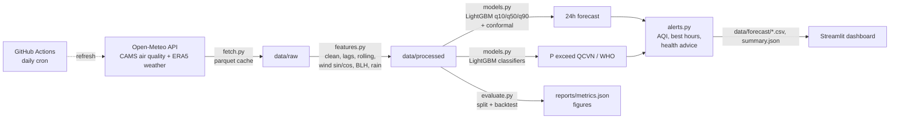

# AirWatch VN 🌫️

**EN:** 24-hour PM2.5 forecasts and early warnings for Hanoi and Ho Chi Minh City, so people know *when* the air will be bad before it happens.
**VI:** Dự báo PM2.5 24 giờ tới và cảnh báo sớm cho Hà Nội và TP.HCM, giúp người dân biết *khi nào* không khí sẽ xấu trước khi nó xảy ra.

[](https://github.com/HThiuhiu/AirWatch-VN-/actions/workflows/ci.yml)
[](https://github.com/HThiuhiu/AirWatch-VN-/actions/workflows/refresh.yml)
[](https://airwatch-vn.streamlit.app)


**Repo:** <https://github.com/HThiuhiu/AirWatch-VN-> · **Demo:** <https://airwatch-vn.streamlit.app>



> Portfolio project for **YDCC 2026** (UNDP Viet Nam × Government of Japan) — data-driven digital solutions for urban air pollution.

---

## Kết quả chính / Key results

Tập test / test set: **2025-11-01 → 2026-11-23**, mọi giờ khởi tạo, horizon 1–24 h (445,739 dự báo). Mô hình chỉ học từ dữ liệu có mục tiêu trước 2025-11-01.
Tất cả số dưới đây lấy từ [`reports/metrics.json`](reports/metrics.json).

### Dự báo điểm / Point forecast — MAE / RMSE (µg/m³, trung bình 24 horizon)

| Thành phố / City | Persistence | Seasonal naive (t−24h) | **LightGBM q50** | Giảm MAE vs baseline tốt nhất |
|---|---|---|---|---|
| Hà Nội | 21.68 / 31.97 | 18.81 / 27.16 | **14.16 / 21.19** | −24.7% |
| TP.HCM | 10.33 / 15.37 | 8.94 / 13.41 | **7.00 / 10.34** | −21.7% |
| Cả hai / Both | 16.00 / 25.08 | 13.87 / 21.41 | **10.58 / 16.67** | −23.7% |

MAE theo horizon (cả hai TP): h=1: persistence **3.95** vs LightGBM 4.07 (persistence nhỉnh hơn ở 1 giờ); h=6: 15.42 vs **9.79**; h=24: seasonal naive 13.88 vs **12.25**.



**Rolling-origin backtest** (8 fold × 3 tháng, cửa sổ mở rộng, 2025-01 → 2026-11): MAE trung bình persistence 16.45, seasonal naive 14.55, **LightGBM 11.13** — LightGBM tốt nhất ở **cả 8/8 fold**.



### Khoảng dự báo / Prediction interval (q10–q90, mục tiêu 80%)

| | Độ phủ trước hiệu chỉnh | **Độ phủ sau hiệu chỉnh conformal** | Độ rộng TB |
|---|---|---|---|
| Cả hai | 73.7% | **80.1%** | 33.5 µg/m³ |
| Hà Nội | – | 80.3% | 44.4 µg/m³ |
| TP.HCM | – | 79.8% | 22.6 µg/m³ |

### Cảnh báo sớm / Early warning — P(TB 24 h tới > ngưỡng)

| Ngưỡng | TP | Tỷ lệ sự kiện | Brier mô hình | Brier persistence | Brier khí hậu | Precision | Recall |
|---|---|---|---|---|---|---|---|
| QCVN > 50 | Hà Nội | 37.8% | **0.133** | 0.233 | 0.276 | 0.78 | 0.71 |
| QCVN > 50 | TP.HCM | 5.2% | **0.036** | 0.054 | 0.065 | 0.72 | 0.24 |
| WHO > 15 | Hà Nội | 97.7% | **0.018** | 0.033 | 0.025 | 0.98 | 1.00 |
| WHO > 15 | TP.HCM | 95.2% | **0.043** | 0.063 | 0.046 | 0.96 | 0.99 |

(Precision/recall ở ngưỡng quyết định p ≥ 0.5.) Ở TP.HCM, vượt QCVN hiếm (5%), nên recall chỉ 0.24 tại p ≥ 0.5 — muốn bắt nhiều sự kiện hơn thì hạ ngưỡng quyết định. Ngưỡng WHO gần như luôn bị vượt, nên cảnh báo WHO ít giá trị phân biệt.



---

## Insight về ô nhiễm / Pollution insights

Chi tiết: [`reports/eda.md`](reports/eda.md) (tự sinh). Giai đoạn 2023-01-01 → 2026-11-23.

| | Hà Nội | TP.HCM |
|---|---|---|
| PM2.5 trung bình | **45.5** µg/m³ | **26.6** µg/m³ |
| Ngày có TB 24h > 50 (QCVN) | **34%** (486/1423) | 4% (56/1423) |
| Ngày có TB 24h > 15 (WHO) | **98%** | 90% |
| Giờ ô nhiễm nhất / sạch nhất | 20h / 11h | 22h / 11h |
| Lớp biên thấp vs cao (25% thấp nhất vs cao nhất) | 69.4 vs 33.6 (×2.1) | 38.4 vs 21.9 (×1.8) |
| Gió lặng vs gió mạnh | 62.6 vs 31.0 (×2.0) | 33.8 vs 19.0 (×1.8) |
| Có mưa 6h qua vs không | 36.3 vs 49.1 | 27.5 vs 26.1 |

1. **Chu kỳ ngày:** đỉnh buổi tối (20–22h), sau giờ tan tầm khi lớp biên hạ thấp; sạch nhất khoảng 11h. → Khung giờ tốt để ra ngoài thường là cuối sáng – đầu chiều.
2. **Lớp biên / nghịch nhiệt là yếu tố mạnh nhất:** khi lớp biên thấp, PM2.5 cao gấp ~2 lần.
3. **Gió pha loãng bụi;** mưa làm sạch rõ ở Hà Nội nhưng không ở TP.HCM.
4. **Mùa:** Hà Nội — mùa đông có nhiều ngày vượt QCVN nhất (40% số ngày, so với 30% mùa hè), tháng có TB cao nhất là tháng 4 (58.0). Chu kỳ mùa trong dữ liệu CAMS **yếu hơn** so với những gì thường thấy ở số liệu trạm. Đỉnh tháng 4 và hướng gió Tây Nam đi kèm PM2.5 cao gợi ý khói đốt sinh khối khu vực — **giả thuyết**, cần dữ liệu trạm để kiểm chứng.
5. **Mô hình học gì (SHAP):** PM2.5 hiện tại, TB 24h qua, giờ trong ngày của thời điểm đích, thành phố, thay đổi so với 24h trước.

| | |
|---|---|
|  |  |
|  |  |

---

## Kiến trúc / Architecture



**Phương pháp / Method**

- **Dữ liệu:** Open-Meteo Air Quality API (`pm2_5, pm10, nitrogen_dioxide, ozone, carbon_monoxide, us_aqi`) + Open-Meteo Archive/Forecast (`temperature_2m, relative_humidity_2m, wind_speed_10m, wind_direction_10m, precipitation, boundary_layer_height`), theo giờ, từ 2023-01-01. Không cần API key.
- **Làm sạch:** chuẩn hóa lưới giờ, bỏ giá trị âm, lọc spike (> 4× trung vị 72h trước và > 150), điền khoảng trống ≤ 3h bằng forward-fill — chỉ dùng quá khứ.
- **Feature tại thời điểm t (chỉ dùng dữ liệu ≤ t):** lag 1/2/3/6/12/24h, rolling mean/max/std 6/24h, TB 72h, chênh lệch 1h/24h, chất ô nhiễm khác, nhiệt độ, độ ẩm, gió (sin/cos, u/v), mưa 6/24h, độ cao lớp biên, giờ, thứ, tháng, mùa, thành phố, horizon, giờ của thời điểm đích.
- **Mô hình:** một LightGBM cho mọi horizon (horizon là feature), hàm mất mát quantile cho q10/q50/q90; khoảng được hiệu chỉnh bằng *conformalized quantile regression* trên tập val (theo thành phố × horizon). Hai bộ phân loại LightGBM cho P(TB 24h tới > 50) và P(> 15).
- **Chống rò rỉ:** chia theo thời gian (train < 2025-07-01 ≤ val < 2025-11-01 ≤ test); bỏ mọi mẫu train có *thời điểm đích* ≥ mốc chia; test chạy trên mọi giờ. Có test tự động kiểm tra feature không đổi khi thay đổi dữ liệu tương lai (`tests/test_features.py`).
- **Ngưỡng (đã kiểm tra):** QCVN 05:2023/BTNMT — PM2.5 TB 24h = **50 µg/m³**; WHO AQG 2021 — PM2.5 TB 24h = **15 µg/m³**. AQI theo thang US EPA (bản sửa đổi 2024, PM2.5 "Tốt" ≤ 9.0), AQI hiện tại dùng NowCast.

---

## Chạy trong 3 lệnh / Run in 3 commands

```bash
git clone https://github.com/HThiuhiu/AirWatch-VN-.git && cd AirWatch-VN-
pip install -r requirements-dev.txt -e .   # 1. cài đặt / install (Python 3.11+)
make all                                   # 2. fetch → EDA → evaluate → train → forecast
streamlit run app/streamlit_app.py         # 3. mở dashboard / open dashboard
```

Không có `make` (Windows)? Dùng `python -m airwatch.cli all`. Từng bước: `python -m airwatch.cli fetch | eda | evaluate | train | forecast`.
Cập nhật dữ liệu mới: `python -m airwatch.cli fetch --refresh`. Kiểm thử: `make test`, `make lint`.

- `fetch` dùng cache `data/raw/*.parquet`, không gọi lại API nếu đã có. Nếu API lỗi, pipeline dùng `data/sample/` để không bị chặn.
- `evaluate` mất ~5–6 phút trên laptop (gồm 8 fold backtest).
- Dashboard chỉ đọc file nhỏ đã commit (`data/forecast/`, `reports/`), nên chạy ngay không cần train.
- Tùy chọn: đặt biến môi trường `OPENAQ_API_KEY` để dùng `airwatch.fetch.fetch_openaq()` lấy danh sách trạm đo thật (OpenAQ v3).

## Cấu trúc / Layout

```
src/airwatch/   config.py fetch.py features.py models.py evaluate.py alerts.py eda.py cli.py
app/            streamlit_app.py
tests/          leak-free features, fetch with sample/mocked API, AQI scale, app smoke test
data/sample/    45 days per city + a frozen forecast (offline demo)
data/forecast/  latest forecast (updated daily by GitHub Actions)
reports/        metrics.json, eda.md, figures/
.github/        ci.yml (ruff + pytest), refresh.yml (daily cron)
```

## Tự động hóa / Automation

- **ci.yml** — `ruff` + `pytest` mỗi lần push / PR.
- **refresh.yml** — mỗi ngày 06:30 giờ VN: fetch tăng dần → train lại (số vòng và hiệu chỉnh lấy từ `metrics.json`) → forecast → commit `data/forecast/*` (vài KB).

## Deploy lên Streamlit Community Cloud

1. Repo: <https://github.com/HThiuhiu/AirWatch-VN-> (public).
2. Vào [share.streamlit.io](https://share.streamlit.io) → **Create app** → repo `HThiuhiu/AirWatch-VN-`, branch `main`, file `app/streamlit_app.py`.
3. *Advanced settings*: Python 3.12; đặt **App URL** = `airwatch-vn` để khớp link demo ở đầu README. Streamlit tự cài `requirements.txt`. Không cần secret.
4. Bật GitHub Actions (Settings → Actions → *Read and write permissions*) để `refresh.yml` được phép commit; app tự hiển thị dự báo mới sau mỗi lần commit.

---

## Hạn chế / Limitations

- **Dữ liệu mô hình, không phải trạm đo.** "Thực tế" ở đây là CAMS reanalysis/forecast (lưới ~0.4°), không phải số đo tại trạm. Mô hình dự báo CAMS, chưa được kiểm chứng với trạm quan trắc. Giá trị tuyệt đối và chu kỳ mùa có thể khác số liệu trạm.
- Không dùng dự báo thời tiết tương lai làm feature (chỉ dùng thông tin có tại thời điểm t) — an toàn về rò rỉ nhưng bỏ lỡ tín hiệu như front lạnh sắp tới.
- Chưa có dữ liệu giao thông, khí thải, cháy (FIRMS), hay dữ liệu theo quận.
- Độ cao lớp biên thiếu từ 2024-01 đến 2024-06 trong ERA5 archive của Open-Meteo (LightGBM xử lý giá trị thiếu).
- Ở 1 giờ tới, persistence vẫn nhỉnh hơn LightGBM một chút; số vòng boosting chọn trên val 2025-07→10 được dùng lại cho các fold backtest sớm hơn (chỉ là siêu tham số, không phải dữ liệu).
- Khuyến nghị sức khỏe chỉ mang tính tham khảo, không thay thế tư vấn y tế.

## Hướng phát triển / Future work

- Cảm biến giá rẻ (PM2.5) + hiệu chỉnh bằng trạm chuẩn; tích hợp trạm thật (OpenAQ, trạm Bộ TN&MT, Đại sứ quán Mỹ).
- Bản đồ theo quận/phường (downscaling), thêm thành phố khác.
- Dùng dự báo thời tiết NWP và dự báo CAMS làm feature; so sánh trực tiếp với CAMS.
- Thông báo đẩy (Zalo OA / Telegram / web push) khi P(vượt QCVN) cao; ngưỡng quyết định tối ưu theo chi phí cảnh báo nhầm.

## Giấy phép / License

MIT — xem [LICENSE](LICENSE). Dữ liệu: [Open-Meteo](https://open-meteo.com/) (CC BY 4.0), chứa thông tin từ Copernicus Atmosphere Monitoring Service và ERA5.
