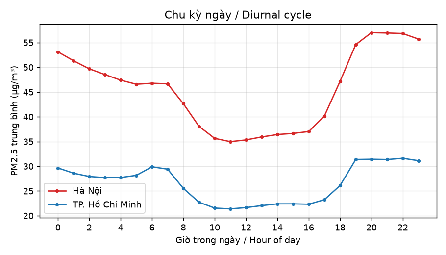
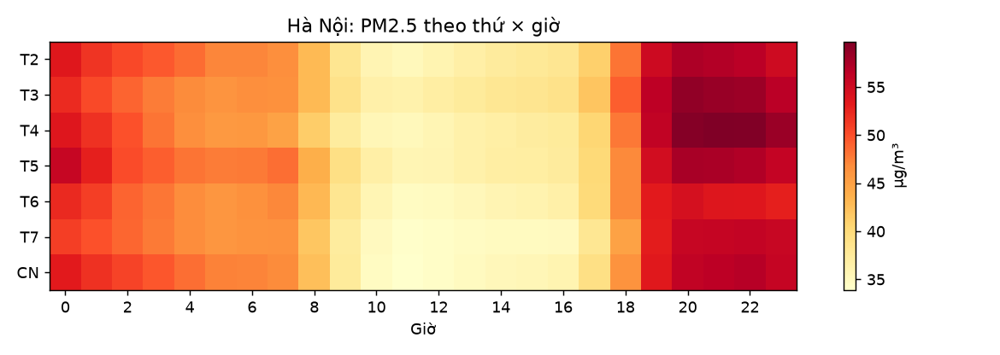
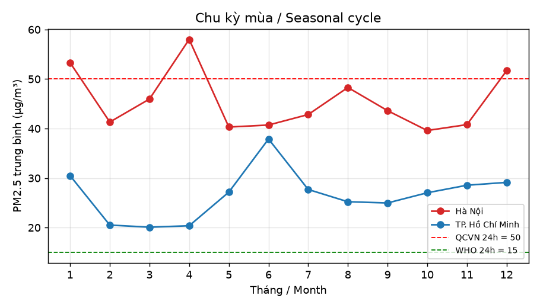
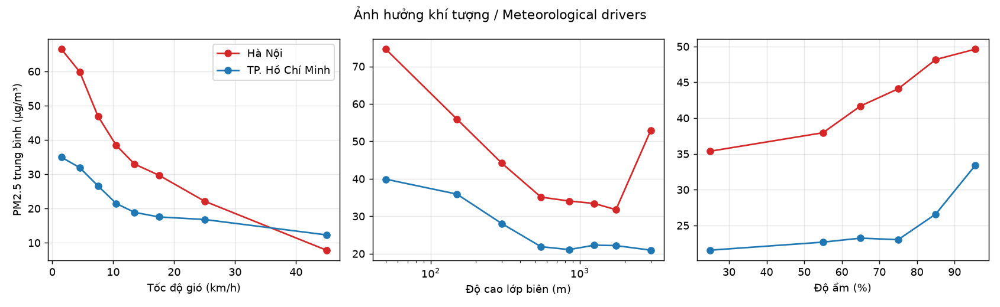
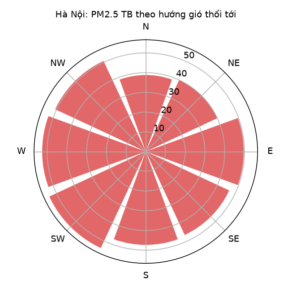

# EDA — AirWatch VN

> Tự sinh bởi `python -m airwatch.cli eda`. Dữ liệu: Open-Meteo / CAMS (mô hình, không phải trạm đo).
> Giai đoạn: Hà Nội 2023-01-01 → 2026-11-23; TP.HCM 2023-01-01 → 2026-11-23.

## 1. Mức ô nhiễm chung

| | Hà Nội | TP.HCM |
|---|---|---|
| PM2.5 trung bình (µg/m³) | 45.5 | 26.6 |
| Số ngày TB 24h > 50 (QCVN) | 486 / 1423 (34%) | 56 / 1423 (4%) |
| Số ngày TB 24h > 15 (WHO) | 1396 / 1423 (98%) | 1280 / 1423 (90%) |

## 2. Chu kỳ ngày

- Hà Nội: cao nhất lúc **20h** (57.0 µg/m³), thấp nhất lúc **11h** (35.0).
- TP.HCM: cao nhất lúc **22h** (31.6), thấp nhất lúc **11h** (21.4).
- Đỉnh buổi tối (sau giờ tan tầm 17–19h) khi lớp biên hạ thấp về đêm; giữa trưa lớp biên cao, khuếch tán tốt nên PM2.5 thấp nhất. Giờ tốt nhất để ra ngoài thường là cuối buổi sáng – đầu giờ chiều.

## 3. Chu kỳ mùa

| | Hà Nội | TP.HCM |
|---|---|---|
| PM2.5 TB mùa đông (T12–T2) | 48.7 | 26.7 |
| PM2.5 TB xuân (T3–T5) | 48.0 | 22.6 |
| PM2.5 TB hè (T6–T8) | 44.0 | 30.2 |
| PM2.5 TB thu (T9–T11) | 41.3 | 26.8 |
| % ngày > 50 µg/m³, mùa đông | 40% | 4% |
| % ngày > 50 µg/m³, hè | 30% | 10% |

- Hà Nội: tháng có PM2.5 TB cao nhất **T4** (58.0 µg/m³), thấp nhất **T10** (39.6).
- TP.HCM: cao nhất **T6** (37.9), thấp nhất **T3** (20.1).
- Hà Nội: mùa đông vẫn là mùa tệ nhất (40% số ngày vượt QCVN so với 30% mùa hè), nhưng **chênh lệch trong dữ liệu CAMS nhỏ hơn** so với những gì thường thấy ở số liệu trạm đo.
- Đỉnh tháng 4 ở Hà Nội có thể liên quan khói đốt sinh khối khu vực (mùa đốt tháng 3–4, gió hướng Tây Nam) — đây là giả thuyết, cần kiểm chứng bằng dữ liệu trạm.

## 4. Khí tượng: gió, mưa, lớp biên

| PM2.5 TB (µg/m³) | Hà Nội | TP.HCM |
|---|---|---|
| Gió lặng (25% thấp nhất) | 62.6 | 33.8 |
| Gió mạnh (25% cao nhất) | 31.0 | 19.0 |
| Có mưa trong 6h qua (> 0.5 mm) | 36.3 | 27.5 |
| Không mưa | 49.1 | 26.1 |
| Lớp biên thấp (25% thấp nhất) | 69.4 | 38.4 |
| Lớp biên cao (25% cao nhất) | 33.6 | 21.9 |
| Tương quan với log(độ cao lớp biên) | -0.52 | -0.45 |
| Tương quan với tốc độ gió | -0.42 | -0.39 |

- Lớp biên thấp (dấu hiệu nghịch nhiệt, khí bị "nhốt" sát mặt đất): PM2.5 cao gấp 2.1 lần (Hà Nội) và 1.8 lần (TP.HCM) so với khi lớp biên cao.
- Gió lặng so với gió mạnh: gấp 2.0 lần (Hà Nội), 1.8 lần (TP.HCM).
- Mưa: Hà Nội sạch hơn khi có mưa (rửa trôi); TP.HCM không sạch hơn khi có mưa — mùa mưa trùng đỉnh tháng 6 trong dữ liệu CAMS.
- Độ cao lớp biên thiếu từ 2024-01 đến 2024-06 trong ERA5 archive của Open-Meteo; các thống kê trên bỏ qua giờ thiếu.

- Hà Nội: gió từ hướng **SW** đi kèm PM2.5 cao nhất, hướng **N** thấp nhất.

## 5. Feature importance

Xem `figures/shap_importance.png` (mean |SHAP| của mô hình LightGBM q50) — sinh ở bước `evaluate`.
